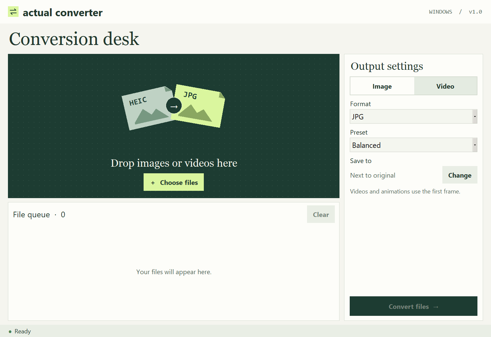

# actual converter

A local, drag-and-drop image and video converter for Windows. Drop a folder's worth of iPhone photos onto the desk, choose **JPG** or **PNG**, and convert the batch. Outputs go beside the originals or into a folder you choose. Existing filenames get a numbered suffix.

## Run on Windows

1. Download **actual-converter-windows.zip** from the [latest release](https://github.com/vikasvyas11/actual-converter/releases/latest) and extract it.
2. Run **Set up.cmd** once. It checks for Python, ImageMagick and FFmpeg and installs missing components using Windows Package Manager.
3. Double-click **actual converter.cmd**. Drop files or press **Ctrl+O**. Select an output type, format and preset, then choose **Convert files**.

Designed for 64-bit Windows 10 and 11. The interface uses Python's built-in Tk desktop toolkit. Conversion works offline. Each engine is installed separately and retains its upstream license.

## Formats

| Output type | Available formats | Input behavior |
| --- | --- | --- |
| Image | JPG, PNG, WebP, HEIC, AVIF, TIFF, BMP, GIF, ICO, JPEG XL, JPEG 2000, TGA, PSD | Saves the first image or video frame. Animated and multipage inputs become a still. Icons include multiple Windows icon sizes. |
| Video | MP4, MOV, MKV, WebM, AVI, M4V, MPG, WMV | Converts the first video track and first audio track when present. A still image becomes a five-second clip. GIF inputs retain their motion. |
| Animation | GIF under the Video tab | Makes a looping animation at 12 fps, up to 720 pixels wide. |

Additional inputs include HEIF, HIF, JFIF, DDS, EXR, HDR, portable bitmap formats, QOI, PCX, MTS, M2TS, TS, FLV, VOB, 3GP and OGV. Decoding depends on the codecs in the installed engines and the contents of the file. Encrypted media, subtitles, Live Photo pairing, camera depth maps and gain maps are outside this release's scope. Pixel formats, color profiles and metadata can change during conversion.

## Speed and batch behavior

Image batches process up to three photos at once. Video jobs run one at a time with multithreaded codecs. MP4, MOV, M4V and MKV use H.264 with the veryfast preset by default. **Copy streams** transfers compressed video and audio into a compatible container at the original quality. If the container rejects a stream, select **Balanced** to re-encode it.

Files appear at their final names only after successful conversion. Cancel stops active conversions and keeps completed outputs. Double-click a saved row to reveal its file, or a failed row to see the engine message. Select a queued row and press Delete to remove it. Running the queue again creates new copies.

## Run from source

With Python 3.10 or later, Tk, ImageMagick 7 (including libheif) and a full FFmpeg build on your computer, run these commands from the checkout:

~~~powershell
py -3 "actual converter.pyw"
py -3 test_converter.py
~~~

The smoke test decodes each advertised output, checks that audio survives video conversion, and exercises stream copying, cancellation and filename collisions. Supply a camera photo as an optional argument to test its HEIC decoding. The Windows release contains the same Python source and requires no pip packages.

Source code is licensed under [MIT](LICENSE). Image and video format details are available in the [ImageMagick format list](https://imagemagick.org/formats/) and [FFmpeg documentation](https://ffmpeg.org/ffmpeg.html).
